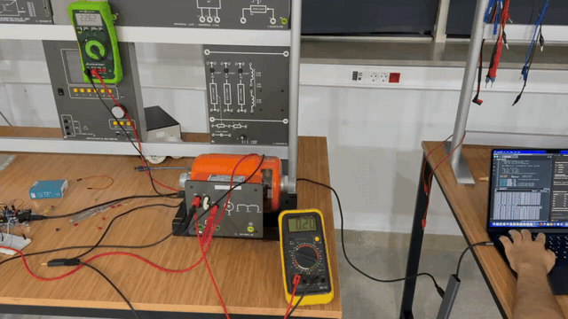
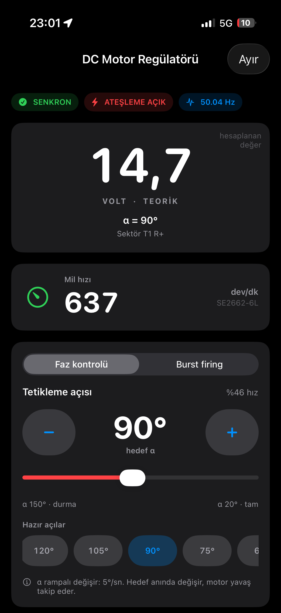
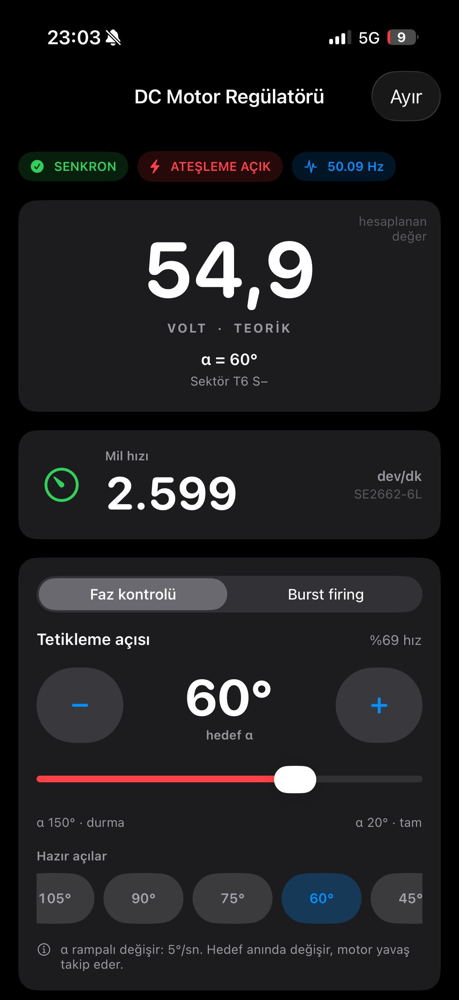

# Three-phase SCR motor control

This is the graduation project I worked on with [Aykut Uluçam](https://github.com/AykutUlucam) and Selen Köse at Başkent University. We built a three-phase rectifier to control a universal motor, then added an iPhone app to adjust the firing angle over Bluetooth and display the motor speed. I was involved in the circuit work, Arduino code, iOS app, assembly and testing.

Thanks to [Berke Yılmaz](https://github.com/BrkeYlmz) for helping us throughout the project.

[](media/lab-demo.mp4)

[Download the full demo video](https://github.com/dorukyksl/three-phase-scr-motor-control/raw/refs/heads/main/media/lab-demo.mp4)

## How it works

The power stage is a B6 bridge built with six SCRs. An Arduino Uno reads the three phase-detection signals and controls the firing angle. We used the isolated supply's 47 V phase setting for the bench tests.

The Arduino handles timing with Timer1 and pin-change interrupts. The HM-10 module uses the hardware serial port, so Bluetooth communication does not block the firing interrupts. We tested the individual channels before moving on to the complete bridge and motor.

The app is written in SwiftUI with CoreBluetooth. It shows the active and requested firing angles, synchronization status, frequency and RPM. The voltage shown in the app is calculated from the firing angle; it is not a measured voltage.

<p>
  
  
</p>

The tachogenerator gives us speed feedback on the screen, but the controller is open loop. There is no PI or PID speed controller in this version. Burst firing is also included for the resistive-load tests, not for driving the motor.

## Code

The main sketch is in [firmware/main/motor_test_ble](firmware/main/motor_test_ble). The [diagnostics folder](firmware/diagnostics) contains the smaller sketches we used while bringing up the circuit. The [iOS project](ios/DC%20Motor%20Regulator) opens in Xcode.

For the Arduino Uno:

```sh
arduino-cli core install arduino:avr@1.8.8
arduino-cli compile --fqbn arduino:avr:uno firmware/main/motor_test_ble
```

The iOS project targets iOS 26.2 or later. Set your own signing team and bundle identifier if you want to install it on an iPhone. The app and code comments are in Turkish.

I put the [timing and pin assignments](docs/architecture.md), [BLE protocol](docs/protocol.md) and [test notes](docs/validation.md) in separate files to keep this page short.

## Hardware notes

The [schematic, PCB and BOM exports](hardware/archive-2026-07-29) are from an earlier revision. Some changes made on the bench are missing from those files, so they should not be used directly for fabrication. The differences are described in [hardware-notes.md](docs/hardware-notes.md).

This is a lab prototype with hazardous voltage and a rotating motor. The overspeed trip is disabled in the saved firmware, and there are still control and protection issues to address. Read the [known issues](docs/validation.md#things-to-fix) before considering any powered use.
